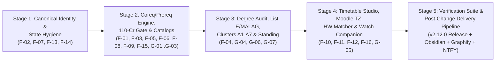

# Semestero ME (`v2.11.4` -> `v2.12.0`) — Standalone Execution Blueprint

> [!IMPORTANT]
> **Blueprint Purpose**: This document is the authoritative, self-contained execution specification for remediating all 16 verified architectural/logic defects (`F-01`–`F-16`) and implementing all 7 Technion Mechanical Engineering capability enhancements (`G-01`–`G-07`) identified in the ARGON 4.0 audit.

---

## 1. Execution Architecture & Stage Topology



| Stage | Target Files | Resolved Audit IDs | Verification Gate |
| :--- | :--- | :--- | :--- |
| **Stage 1** | `app.js`, `grade_sheet.js`, `planner_module.js`, `auth_sync.js`, `ui_enhancements.js` | `F-02`, `F-07`, `F-13`, `F-14` | Zero duplicate Physics nodes/credits/tasks; scoped user state keys; tombstone-aware cloud sync. |
| **Stage 2** | `planner_catalog.js`, `curriculum_template.js`, `planner_module.js`, `app.js`, `ui_enhancements.js` | `F-01`, `F-03`, `F-05`, `F-06`, `F-08`, `F-09`, `F-15`, `G-01`, `G-02`, `G-03` | Zero false `⚠️ קדם` warnings on default 2024/2026/2027/Barak templates; 110-cr capstone gate active; dashed coreq beams in DAG. |
| **Stage 3** | `planner_catalog.js`, `planner_module.js`, `grade_sheet.js`, `app.js` | `F-04`, `G-04`, `G-06`, `G-07` | List E ME electives separated from MALAG; zero double-counting in `checkSpecialRequirements`; A1–A7 clusters & Tkinut Akademit badge live. |
| **Stage 4** | `timetable_generator.js`, `moodle_sync.js`, `calendar_sync_engine.js`, `attendance_hub.js`, `watch_companion.js`, `app.js` | `F-10`, `F-11`, `F-12`, `F-16`, `G-05` | Dynamic CheeseFork group ingestion for Semesters 1–8; unified pre-anchor keys; local-TZ Moodle deadlines; Oct 28 start date; live Watch state. |
| **Stage 5** | `package.json`, `app.js`, `index.html`, `sw.js`, `android/app/build.gradle`, `wear/build.gradle`, Obsidian Vault, `graphify-out/` | All (`F-01`–`F-16`, `G-01`–`G-07`) | Automated test suite green, version bumped to `2.12.0`, Git pushed, Electron synced, Obsidian ADR + Graphify updated, NTFY sent. |

---

## 2. Detailed Surgical Implementation Plan

### Stage 1: Canonical Course Identity, Root Deduplication & Multi-Tenant State Hygiene (`F-02`, `F-07`, `F-13`, `F-14`)

#### 1.1 Fix Dual-Key Physics Variant Duplication (`F-02`)
- **Target**: `selectPhysicsVariant` in `app.js` (lines 12720–12880).
- **Problem**: Lines 12809–12810 assign `gameState.courses[targetMeta.altCode] = existingCourse; gameState.courses[targetMeta.code] = existingCourse;`, inserting two keys pointing to the same course object in `gameState.courses`.
- **Implementation**:
  1. Store the course under a **single canonical key** in `gameState.courses` (`targetMeta.altCode`, while keeping `existingCourse.code = targetMeta.altCode` and `existingCourse.altCode = targetMeta.code`), and delete any secondary alias key from `gameState.courses`.
  2. Add a global helper `getDeduplicatedCoursesList(coursesMap = gameState.courses)` in `app.js` that deduplicates by canonical root (`normalizeCourseCodeForFlowchart(c.code || k).replace(/^0+/, '')`) and object reference (`Set`).
  3. Use `getDeduplicatedCoursesList()` across:
     - `recalculateCourseStates` (`app.js` lines 10313–10386)
     - `renderFlowchartTree` (`app.js` lines 21056–21179)
     - `renderNotionTasksTable` (`app.js` line 17353)
     - `GradeSheet.calculateAcademicLedger` (`grade_sheet.js` lines 111–157)

#### 1.2 Fix Contamination Heuristic & Scope Developer-Specific Overrides (`F-07`)
- **Targets**: `isAdirPlanAuthentic` (`planner_module.js` lines 66–78), `sanitizeInboundState` (`auth_sync.js` lines 324–352), `syncPlannerToTree` (`planner_module.js` lines 1054–1098), `saveCustomPlan` (`planner_module.js` lines 1337–1346), `recalculateCourseStates` (`app.js` lines 10422–10425), `renderFlowchartTree` (`app.js` lines 20846–20870), and `ui_enhancements.js` (lines 22–26).
- **Implementation**:
  1. Include `hasYogaInS3` in `isAdirPlanAuthentic` (`return hasPhys1InS1 && hasChemLabInS2 && hasYogaInS3;`) and stamp saved degree plans with `ownerUserId` in the v2 storage payload.
  2. Scope the Semester 4 Sports/MALAG purge (`0394*` / `0324*` in Sem 4) and Chemistry Lab (`125013` -> Sem 2) lock strictly to `isAdirActive()` (`activeUid === 'adir_moshe'`).
  3. Scope `CourseWishlist` and `RecentlyViewed` keys in `ui_enhancements.js` by active user ID.

#### 1.3 Fix Frozen `lastModified` Timestamp & Cloud Sync Tombstone Clobbering (`F-13`, `F-14`)
- **Targets**: `saveState` (`app.js` lines 10091–10096), `setupRealtimeSubscription` (`auth_sync.js` lines 2708–2721), and `pullLatestStateFromCloud` (`auth_sync.js` lines 2833–2846).
- **Implementation**:
  1. In `saveState()`, always set `gameState.lastModified = Date.now();`.
  2. In `auth_sync.js`, filter out any course codes present in `localState.removedCourses` when computing `remoteHasMoreCourses`, preventing stale cloud snapshots from resurrecting locally deleted electives.

---

### Stage 2: Corequisite (`coreqs`) & OR-Group Engine, 110-Credit Capstone Gate & Catalog Integrity (`F-01`, `F-03`, `F-05`, `F-06`, `F-08`, `F-09`, `F-15`, `G-01`–`G-03`)

#### 2.1 First-Class Corequisites (`coreqs` / מקצועות צמודים) & Boolean OR-Groups (`F-01`, `F-09`, `G-01`, `G-03`)
- **Targets**: `planner_catalog.js`, `curriculum_template.js`, `checkPrerequisites` (`planner_module.js` lines 1426–1472), `recalculateCourseStates` (`app.js` lines 10427–10501), and `renderFlowchartTree` (`app.js` lines 21055–21103).
- **Implementation**:
  1. Add `coreqs: [...]` ($p_{\text{sem}} \le s_{\text{course}}$) and `prereqGroups: [[...]]` support to `checkPrerequisites` and `recalculateCourseStates`.
  2. Update `01140039` (Physics Lab 1M) across `2024`, `2026`, `2027`, and `Barak` in `planner_catalog.js` to use `coreqs: ["01140051"]`.
  3. Update Barak track courses (`01250013` in Sem 1 -> `coreqs: ["01250001"]`, `01140075` in Sem 2 -> `prereqs: ["01140071"], coreqs: ["01040043"]`, `00340041` in Sem 4 -> `prereqs: ["00340035", "01040228"], coreqs: ["00340055"]`).
  4. Set `prereqs: ["00340054"]` on `00340382` (Engineering Methodology 1) across `planner_catalog.js`, and clean up the duplicate Physics 1 code in `034010` (Dynamics) in `curriculum_template.js`.
  5. Render `coreqs` connections as dashed cyan beams (`fc-beam coreq`) in `renderFlowchartTree`.

#### 2.2 Implement the 110.0-Credit Capstone Gate & Align FAQ (`F-03`, `G-02`)
- **Targets**: `planner_catalog.js` (`00340379`, `00340384`), `planner_module.js` (`checkPrerequisites`, `evaluateDegreeRules`), and `ui_enhancements.js` (`FAQ_ITEMS` line 1172).
- **Implementation**:
  1. Add `minCreditsRequired: 110.0` to `00340379` and `00340384`, and validate cumulative prior-semester credits in `checkPrerequisites` and `evaluateDegreeRules`.
  2. Update `FAQ_ITEMS` in `ui_enhancements.js` to state `110 נק״ז` and 8-digit course codes.

#### 2.3 Fix Physics 1 Credit Corruption, Catalog Cohort Mapping, Track Migration & Seasonal Twin Bug (`F-05`, `F-06`, `F-08`, `F-15`)
- **Targets**: `planner_module.js` (lines 2564–2568, 3385–3400) and `planner_catalog.js` (lines 293, 770–797, 838–840).
- **Implementation**:
  1. Fix `01140071` (`3.5` cr) and `01140051` (`2.5` cr) in `renderAddElectivesSection`.
  2. Point `CURRICULUM_CATALOGS.year_2027` to `SUGGESTED_MANDATORY_SYLLABUS_2027` and `year_2024` to `SUGGESTED_MANDATORY_SYLLABUS_2024`.
  3. Call `migratePlanToTrack(selectedTrack)` when switching `#planner-track-select`.
  4. Remove the erroneous `'00340030' <-> '00340043'` mapping in `SEASONAL_COURSE_MAPPINGS` and fix Sem 2 `targetCredits: 21.0` in `SUGGESTED_MANDATORY_SYLLABUS_2026`.

---

### Stage 3: Graduation Clearance Audit, List E vs. MALAG Separation, Specialization Clusters A1–A7 & Academic Standing (`F-04`, `G-04`, `G-06`, `G-07`)

#### 3.1 Fix List E / MALAG Conflation & Deduplicate `checkSpecialRequirements` (`F-04`)
- **Targets**: `planner_catalog.js` (`listE`) and `planner_module.js` (`evaluateDegreeRules` lines 1649–1765).
- **Implementation**:
  1. Separate `list: 'E'` (Mechanical Engineering Faculty Electives) from `list: 'MALAG'` (`0324*`).
  2. Add a `seenSpecialCodes = new Set()` deduplication guard inside `checkSpecialRequirements(c)` so courses in `plan`, `unassignedCourses`, and `gameState.courses` are never double-counted.

#### 3.2 Add Specialization Clusters (Lists A1–A7) & Academic Standing (תקינות אקדמית) Monitor (`G-04`, `G-06`, `G-07`)
- **Targets**: `planner_catalog.js`, `planner_module.js`, `grade_sheet.js`, and `app.js`.
- **Implementation**:
  1. Tag List A courses with official Technion ME specialization clusters (`A1`–`A5`) and surface cluster progress in `evaluateDegreeRules` and the Graduation Clearance modal.
  2. Compute Academic Standing (`gpa >= 65.0` and passed/attempted credits ratio `>= 0.66`) in `GradeSheet.calculateAcademicLedger()`.
  3. Preserve upcoming Moed B exam dates on `mastered` courses when `improveInMoedB` or Moed B task flags are present.

---

### Stage 4: Full-Degree Timetable Studio, Moodle Local-TZ Sync, Homework Matcher & Watch Companion (`F-10`, `F-11`, `F-12`, `F-16`, `G-05`)

#### 4.1 Dynamic CheeseFork Group Ingestion & Unified Pre-Anchor Keys (`F-10`, `G-05`)
- **Target**: `timetable_generator.js` (lines 605–665, 1104–1455).
- **Implementation**:
  1. Automatically bridge active semester courses from `window.CHEESEFORK_DB` and `gameState.courses` into `ingestCheeseForkCourseGroups` on studio open/generation.
  2. Standardize `renderPreAnchorHub` anchor keys to `${item.code}_${slotType}` to match `toggleAnchor` and `generateTimetableCombinations`.

#### 4.2 Fix Moodle ICS 8-Digit Code Lookup & Local Israel Timezone Formatting (`F-11`)
- **Target**: `moodle_sync.js` (lines 1110–1155).
- **Implementation**:
  1. Preserve 8-digit codes when the 4-digit course suffix is $\ge 1000$ (`03240269`, `03940805`) and match against both 8-digit and 6-digit keys.
  2. Format `dueDateObj` in local Israel time (`YYYY-MM-DD HH:mm`) instead of UTC `.toISOString()`.

#### 4.3 Refine Homework Sheet Index Matcher (`app.js`)
- **Target**: `app.js` (lines 29052–29062, 29528–29660).
- **Implementation**:
  1. Prioritize explicit sheet/homework keywords (`גיליון`, `תרגיל`, `מטלה`, `hw`, `quiz`) and strip course name prefixes before extracting the sheet index so `"מוצקים 2 - גיליון 5"` maps to Sheet `5`.

#### 4.4 Unify October 28, 2026 Semester Start Date & Live Watch Companion Binding (`F-12`, `F-16`)
- **Targets**: `calendar_sync_engine.js` (line 14), `attendance_hub.js` (line 477), and `watch_companion.js` (lines 376–446).
- **Implementation**:
  1. Set `DEFAULT_SEM_START` and `semStart` to `new Date(2026, 9, 28)` (October 28, 2026).
  2. Replace hardcoded course/credit/honors strings in `watch_companion.js` with live `state` values and persist `toggleWatchTask` updates to `localStorage` and `window.opener`.

---

### Stage 5: Automated Verification & Semestero Post-Change Delivery Pipeline

1. **Automated Verification**: Run `node --check` on all modified files and execute the automated verification suite testing `F-01`–`F-16` and `G-01`–`G-07`.
2. **Post-Change Delivery Lifecycle**:
   - Bump version to `2.12.0` across `package.json`, `app.js`, `index.html`, `sw.js`, and Android `build.gradle`.
   - Commit and push to `origin/main`.
   - Sync Electron desktop client.
   - Log `ADR-109` and Session Log in Obsidian Second Brain (`05_MOC/MOC_Atlas_ME.md`) and run `graphify update .`.
   - Send NTFY notification to `adir-semestero-me-updates`.

---

## 3. Ready-to-Use Downstream Prompts

### Activation Prompt

```text
Execute the approved Semestero ME (v2.11.4 -> v2.12.0) Standalone Execution Blueprint located at:
C:\Users\user\.gemini\antigravity\scratch\academic-skill-tree\SEMESTERO_ME_EXECUTION_BLUEPRINT.md

Execute Stages 1 through 5 sequentially and surgically without skipping any item:
1. Stage 1: Canonical Course Identity, Root Deduplication & Multi-Tenant State Hygiene (F-02, F-07, F-13, F-14) in app.js, grade_sheet.js, planner_module.js, auth_sync.js, and ui_enhancements.js.
2. Stage 2: Corequisite (coreqs) & OR-Group Engine, 110.0-Credit Capstone Gate, Physics 1 Credit Fix, Catalog Cohort Mapping, Non-Destructive Track Switch (migratePlanToTrack), and Seasonal Twin Fix (F-01, F-03, F-05, F-06, F-08, F-09, F-15, G-01..G-03) in planner_catalog.js, curriculum_template.js, planner_module.js, app.js, and ui_enhancements.js.
3. Stage 3: Graduation Clearance Audit Deduplication, List E vs. MALAG Separation, Specialization Clusters (Lists A1-A7), Academic Standing (Tkinut Akademit) Monitor, and Moed B Exam Date Preservation (F-04, G-04, G-06, G-07) in planner_catalog.js, planner_module.js, grade_sheet.js, and app.js.
4. Stage 4: Dynamic CheeseFork Group Ingestion & Unified Pre-Anchor Keys in Timetable Studio, Moodle 8-Digit Code & Local-TZ Deadline Formatting, Homework Sheet Number Matcher Refinement, Unified Oct 28, 2026 Semester Start Date, and Live Watch Companion Binding (F-10, F-11, F-12, F-16, G-05) in timetable_generator.js, moodle_sync.js, calendar_sync_engine.js, attendance_hub.js, watch_companion.js, and app.js.
5. Stage 5: Run full syntax and logic verification tests, then execute the complete Semestero Automated Post-Change Pipeline (Version Bump to v2.12.0 across all manifests, Git commit & push to origin/main, Electron sync, Obsidian Second Brain ADR-109 + Session Log + MOC update, Graphify update, and NTFY push notification to adir-semestero-me-updates).
```

### Continuation Prompt

```text
Resume execution of the Semestero ME (v2.11.4 -> v2.12.0) Standalone Execution Blueprint at:
C:\Users\user\.gemini\antigravity\scratch\academic-skill-tree\SEMESTERO_ME_EXECUTION_BLUEPRINT.md

1. Inspect `git status` and `git diff` in `C:\Users\user\.gemini\antigravity\scratch\academic-skill-tree` to determine which stages (Stage 1 through Stage 5) are already completed and verified.
2. Immediately continue from the first incomplete stage in SEMESTERO_ME_EXECUTION_BLUEPRINT.md without redoing completed work.
3. Verify all modified JavaScript files with `node --check` and run the verification harness covering F-01..F-16 and G-01..G-07.
4. Upon completing all code stages, execute Stage 5 (Semestero Automated Post-Change Pipeline: bump version to 2.12.0 across package.json, app.js, index.html, sw.js, and Android build.gradle; commit and push to origin/main; sync Electron; log ADR-109 and Session Log in Obsidian Second Brain; run `graphify update .`; and send the NTFY completion alert to `adir-semestero-me-updates`).
```
